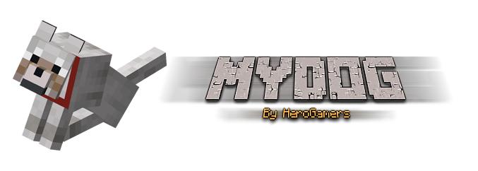

<h1 align="center">MyDog</h1>
<div align="center">

[](https://github.com/HeroGamers/MyDog/actions/workflows/build.yml)
</div>

Tamed wolves but at least 10x better.

___

<div align="center">

[](https://github.com/HeroGamers/MyDog/releases)
</div>

## Main Plugin Features
*	Dogs teleport upon chunk-unloading, on player-teleport as well as if the player is more than 30 blocks (configurable) away from their dog, so that the Dogs can always follow their owner. Requires the Dog to not sit (all other Tameables can also be set to teleport on chunk-unload and player-teleportation (not distance) in the config).
*	500+ unique randomly generated dog names.
*	Dogs can gain experience and level up by killing mobs.
*	Configurable option for gaining XP from killing players.
*	Dogs get more health and deal more damage the higher their level is.
*	A beautiful overview over your Dog's stats, including XP, health, damage and last known location.
*	Update the color of your Dog's nametag when their collar gets coloured.
*	Puppies, from breeding two Dogs, become Dogs in MyDog as well.
*	Nametag and name updates when the Dogs collar gets coloured, or the Dog gets a nametag applied (deny the rename permission for nametag-only).
*	The ability to add currently existing Tamed Wolves to the MyDog system, and register them as new Dogs (interact with them).
*	Dog treats change your dog's breed or personality (how it sounds). Each one has its own, expensive, configurable recipe, or can be handed out by admins only, e.g. for shops and auctions.
*	Dogs from before wolf breeds and personalities existed get to pick theirs once, for free.
*	Configurable all the way from the sound on LevelUp, the level table and the experience per mob, to every message (written in [MiniMessage](https://docs.advntr.dev/minimessage/format.html), in messages.yml).

### ToDo Feature-list
To view the list of features, please visit the [project page](https://github.com/users/HeroGamers/projects/1).

For new feature requests, please open a GitHub Issue.

## Requirements
*	A Spigot or Paper server on Minecraft 26.1 or newer, running Java 25.
*	Optional: [Vault](https://www.spigotmc.org/resources/vault.34315/) and an economy plugin, for trading dogs for money and paying for revivals.

## Upgrading from 0.2.x
MyDog upgrades `config.yml` and `dogs.yml` by itself on the first start, and keeps the old files as `config.yml.v1.bak` and `dogs.yml.v1.bak`.
Messages now live in `messages.yml` and use [MiniMessage](https://docs.advntr.dev/minimessage/format.html) instead of `&` color codes; any messages you had changed are converted and moved there.

## Resources
*	Resource page on [Spigot](https://www.spigotmc.org/resources/mydog.70260/).
*	Project page on [Bukkit](https://dev.bukkit.org/projects/mydog).

## Permissions
```YAML
mydog.*:
    description: Gives access to all MyDog commands
    default: false
mydog.limit.*:
  description: Give limits to the amount of dogs a player can tame.
  default: false
mydog.teleport:
  description: Player's tamed wolves will teleport to the player
  default: true
mydog.help:
  description: Player can view the MyDog command list
  default: true
mydog.putdown:
  description: Player can kill their Dog with a command
  default: true
mydog.comehere:
  description: Player can force their Dogs to load and teleport to the position of the player
  default: true
mydog.dogs:
  description: Player can get an overview about their Dogs
  default: true
mydog.stats:
  description: Player can view stats about their Dogs
  default: true
mydog.rename:
  description: Player can rename their Dogs
  default: true
mydog.sit:
  description: Player can have dogs sit and stand up
  default: true
mydog.setid:
  description: Player can set a custom ID to their Dogs
  default: true
mydog.togglemode:
  description: Player can toggle dogs between attack and defend mode
  default: true
mydog.calm:
  description: Player can calm their dogs down
  default: true
mydog.store:
  description: Player can store their dogs away and summon them again
  default: true
mydog.share:
  description: Player can share their dogs with friends, who can then look after them
  default: true
mydog.admin.others:
  description: Player can use commands on any player's dogs (as owner:id) and list them with /mydog list <player>
  default: false
mydog.harm.others:
  description: Player can hurt other players' dogs, even when dogs.protection.from-other-players is on
  default: false
mydog.pet:
  description: Player can pet their dogs
  default: true
mydog.pet.others:
  description: Player can pet others dogs
  default: true
mydog.editlevel:
  description: Player can set the level of their dogs
  default: false
mydog.dead:
  description: Player can see the list of dead dogs
  default: true
mydog.revive:
  description: Player can revive dead dogs
  default: true
mydog.free:
  description: Player can set their Dogs free
  default: true
mydog.trade:
  description: Players can trade their dogs
  default: true
mydog.reload:
  description: Player can reload the configuration(s)
  default: false
mydog.save:
  description: Player can save the configuration(s)
  default: false
mydog.breed:
  description: Player can see their dogs' breed and personality, and pick them for dogs from before those existed
  default: true
mydog.givetreat:
  description: Player can give dog treats to players (also works from the console)
  default: false
```

## Bug reports and issues
Visit the [Issues Tab](https://github.com/HeroGamers/MyDog/issues).
